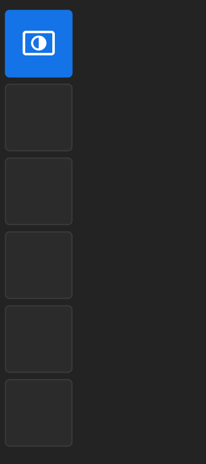
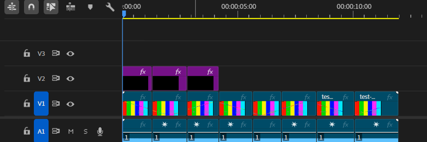
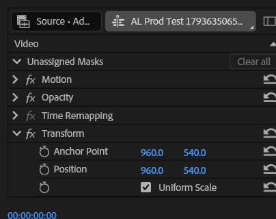

# openClick

<p align="center">
  
</p>

<p align="center">
  <b>A two-tool Adobe Premiere Pro panel that adds adjustment layers to selected clips<br>
  and nests or unnests clips, with exact timing and the Transform(openClick) preset applied.</b>
</p>

<p align="center">
  <a href="https://github.com/Ns345543/openClick/releases/latest"></a>
  
  
  
</p>

openClick is a slim vertical toolbar styled after Premiere's native Tools panel. Select one
or more video clips, click the blue layer tool, and every selected clip receives a genuine
adjustment layer on the first free video track above it, with the same In and Out points.
Hold **Shift** while clicking to create one combined layer across the whole selection,
placed above the highest selected track.

The second tool nests clips: click it to nest each selected clip separately, **Shift+click**
to nest the whole selection into one clip, or **Alt+click** to expand every nested clip on
the active sequence back into its source clips.

Existing timeline content is never moved, trimmed, replaced, or deleted.

## Screenshots

| Timeline result | Effect Controls |
| :---: | :---: |
|  |  |
| Three selected V1 clips produced three adjustment layers on V2, each with the same In and Out points as its clip. | Every new layer opens with **Transform(openClick)** applied. Uniform Scale is checked. |

## Download

| Package | Download | Use it with |
| --- | --- | --- |
| Signed ZXP | [**openClick.zxp**](https://github.com/Ns345543/openClick/releases/latest/download/openClick.zxp) | ZXP Installer, Anastasiy's Extension Manager, or `ExManCmd` |
| Manual ZIP | [**openClick.zip**](https://github.com/Ns345543/openClick/releases/latest/download/openClick.zip) | Copy the `com.openclick2` folder into the CEP extensions folder |
| Source | [**openClick-source.zip**](https://github.com/Ns345543/openClick/releases/latest/download/openClick-source.zip) | Repository sources for this tag (also available from GitHub's "Source code" links) |

Both packages contain the same extension. The ZXP adds signature metadata; the ZIP adds
`INSTALL.txt`. Neither package contains a `.debug` file. Install one format only.

All versions: [github.com/Ns345543/openClick/releases](https://github.com/Ns345543/openClick/releases)

## Requirements

- Adobe Premiere Pro 2022 (22.0) or newer.
- CEP 9 or newer (bundled with Premiere Pro).
- Tested on Adobe Premiere Pro 2026 (26.5.2.5) on Windows 10 x64.

## Install

The extension ID is `com.openclick2`. It does not replace the retired
`com.openclick` / `com.openclick.probe` builds, or the older
`com.adjustmentlayer.creator` build. Delete those folders if they still exist so only one
openClick panel appears.

### Option A: signed ZXP

1. Close Premiere Pro.
2. Install `openClick.zxp` with a ZXP installer, such as ZXP Installer, Anastasiy's
   Extension Manager, or Adobe ExManCmd:
   `ExManCmd.exe /install "openClick.zxp"`.
3. Start Premiere Pro and open a project.
4. Open **Window > Extensions > openClick**.

The package is signed with a self-signed certificate, so the installer may show a warning.
The signature itself is valid:

- Signer: `CN=openClick`
- `ZXPSignCmd -verify openClick.zxp` reports `Signature verified successfully`

If the panel does not appear in the Extensions menu after a self-signed install, enable
`PlayerDebugMode` as described in Option B.

### Option B: manual ZIP

1. Close Premiere Pro.
2. Copy the `com.openclick2` folder from the ZIP into:
   `C:\Users\<user>\AppData\Roaming\Adobe\CEP\extensions\`
   Create the `extensions` folder if it does not exist. The final path must be:
   `...\Adobe\CEP\extensions\com.openclick2\CSXS\manifest.xml`
3. Enable manually installed extensions:
   - Open Registry Editor.
   - Under `HKEY_CURRENT_USER\SOFTWARE\Adobe`, create the key `CSXS.12` if missing.
   - Add a String value `PlayerDebugMode` with data `1`.
   - Repeat for `CSXS.13` if that key exists or if the panel does not appear.
4. Start Premiere Pro and open a project.
5. Open **Window > Extensions > openClick**.

The same instructions ship as `INSTALL.txt` inside the ZIP.

## Use

1. Open a project and a sequence.
2. Select one or more video clips in the timeline.
3. In the panel, click the blue adjustment layer tool.
   Hold **Shift** while clicking to create one combined layer instead.
4. The status line under the toolbar reports the result. Double-click a new layer to see
   its Transform(openClick) effect in Effect Controls.

| Action | Result |
| --- | --- |
| **Click**, one clip selected | One adjustment layer on the first free track above the clip, from its exact In to its exact Out point. |
| **Click**, several clips selected | One layer per selected clip, each with that clip's own In and Out points. Clips are handled bottom-up, so overlapping selections stack instead of overwriting. |
| **Shift+click**, several clips selected | One layer from the earliest selected In point to the latest selected Out point, above the highest selected track so it affects the whole selection. |
| **Shift+click**, one clip selected | Same result as a normal click. |
| Linked video + audio selected | Treated as one video clip; the layer uses the video timing. |
| Track directly above is occupied | The extension searches upward and uses the first track with no overlapping clip in that time range. |
| Every track above is occupied | One video track is added above the top track, and the layer is placed there. |
| Locked track above | Skipped, because content cannot be placed on it; the search continues upward. |
| No video clip selected | Nothing is created; the panel asks for a video clip. |
| No project or active sequence | Nothing is created; the panel reports the state. |

Every created adjustment layer carries the **Mango** label color, so layers are easy to
spot in the timeline and project panel.

### Nested Clips

The second tool works on the current selection:

| Action | Result |
| --- | --- |
| **Click**, one or more clips selected | Each selected clip is replaced by its own nested-sequence clip, with the same In and Out points. |
| **Shift+click**, several clips selected | All selected clips are replaced by one nested-sequence clip spanning the selection. |
| **Alt+click** | Every nested clip on the active sequence is expanded back into its source clips, at their original positions. |

Unnesting restores trimmed clips through subclips (Premiere's overwrite call does not honor
project-item In/Out points), keeps the restored clips selected, and only reports success
when the timeline diff shows nothing but nest clips removed and source clips added inside
the nest ranges. If any nest cannot be expanded safely, nothing is changed. Effects or
speed changes applied *inside* a nest are not recreated, and the emptied nested sequences
stay in the project panel.

## The Transform(openClick) preset

Every layer created by openClick, in every mode, already carries
`Transform(openClick)` in its Effect Controls. Nothing needs to be imported by hand.

- Effect: `Transform` (preset match name `AE.ADBE Geometry2`)
- **Uniform Scale: checked**
- Use Composition's Shutter Angle: off
- Shutter Angle: 360
- Sampling: 0

The preset ships inside the extension at
`presets/Transform(openClick).prfpset` and is read on every click. To change what new
layers receive, save a new version of the preset from Premiere and replace that file,
keeping the name.

Premiere exposes two effects named Transform: the current one (`AE.ADBE Geometry2`) and a
legacy one (`AE.ADBE Geometry`). The QE lookup in Premiere 2026 returns only the legacy
match name, even though the effect it creates has the full modern control set. openClick
checks the effect that was actually added; when it has exactly the preset's parameter set,
the values are written in place and the layer is kept. The layer is inserted once and
never deleted and re-added, so the timeline does not flicker. The working lookup is cached
for later clicks. If the added effect is not usable, that layer is replaced with a clean
one and the next lookup is tried. Parameter values are applied by position (language
independent), with a name-based fallback, then read back and verified.

If the preset cannot be applied and verified, the layer and every layer added in that run
are removed, and the panel reports the failure.

## Safety guarantees

- Existing timeline content is never overwritten, deleted, or replaced.
- Selected clips keep their position, duration, effects, and properties.
- Candidate tracks are checked for overlapping media and lock state before any change.
- After each insertion, the extension re-reads the timeline and verifies that exactly one
  clip was added and no existing clip was removed or changed.
- It then verifies that Transform(openClick) is present with its stored values.
- If either verification fails, the inserted layer and every layer added earlier in the
  same run are removed.
- Errors are always reported in the panel; nothing fails silently.

## What is created

The extension produces a real Premiere Pro adjustment layer, not black video, a
transparent placeholder, or an ordinary clip. Premiere reports it with
`isAdjustmentLayer() === true`. Timing is written in ticks, not seconds, so the layer
starts and ends on exactly the same ticks as the selected clip.

The layer source is a minimal uncompressed donor project shipped inside the extension. On
each new frame rate, a rate-matched copy is written to the system temp folder and imported;
a clip from its adjustment layer item is placed, then the imported sequence is removed
from the project panel. Frame-rate matching matters because Premiere quantizes project-item
marks to the donor media's frame rate; without it the Out point can land one frame short.
The imported adjustment layer item is cached and reused for later clicks in the same
project and frame rate.

## Verified in Premiere Pro 26.5.2.5

- Layer placed directly above a selected clip with tick-exact timing on 25 fps and 30 fps
  sequences; both matched the source clip tick for tick.
- Original clips unchanged; the timeline diff reported zero clips removed or changed.
- Linked video + audio selection treated as one video clip.
- Highest-track case: a video track was added and the layer placed on it.
- No selection and audio-only selection refused with no timeline changes.
- Three clips across V1 and V2 produced three layers at the clips' exact ticks; originals
  untouched.
- Shift+click across two V1 clips produced one layer spanning their union on V2; adding a
  V2 clip to the selection produced one layer on V4 spanning all three, correctly skipping
  the occupied V3.
- Preset read back from every new layer in every mode:
  `Uniform Scale = true`, `Use Composition's Shutter Angle = false`,
  `Shutter Angle = 360`, `Sampling = 0`. A pre-existing layer on V5 was not modified.
- Smooth insertion (1.0.2): exactly one timeline insertion and zero rollbacks per click.
  A single-clip click completed in 303 ms and a two-clip click in 431 ms, with preset
  values verified on every new layer.
- Track search validated for immediate free track, occupied tracks, all tracks occupied,
  boundary-touching clips, and locked tracks.
- The donor sequence was removed after placement; no duplicate items were left behind.
- Nesting validated live in Premiere: 7 of 7 nests placed correctly across multi-selection,
  consecutive linked clips, and Shift+click combined nesting.
- Unnest validated against a mock of the Premiere API covering 18 scenarios: single and
  combined nests, trimmed sources, multi-nest commands, subclip unit quirks, and refusals
  that leave the timeline untouched. Live Alt+click confirmation is still in progress.
- Panel driven with real mouse clicks under the `com.openclick2` ID; the toolbar renders,
  the status line reports the result, and the layout was checked at 30, 48, 120, and
  ~160 px panel widths with no tool pushed out of view.

## Panel design

The panel is a column of square tool boxes that mirrors Premiere's Tools panel: the same
`#232323` background, rounded tiles, line icons at 60% of the tile size, and a purple focus
ring. The column is anchored at the top-left and follows the panel width, so the tools stay
visible when the panel is narrowed.

The first two slots are the live **Add Adjustment Layer** and **Nested Clips** tools. The
four slots below them are inert placeholders reserving space for future tools. Replacing a
placeholder means swapping its `<span class="tool-slot">` for a `<button class="tool">` with
an inline SVG; hover, press, focus, and busy states are already defined.

Each box uses `width: 100%; max-width: 44px; aspect-ratio: 1`, so it fills a narrow panel
edge to edge and caps at 44 px on a wide one. Visual values live in CSS custom properties
at the top of `css/style.css`. The default panel size is 64 x 320 px (minimum 48 x 120,
maximum 320 x 1200), and the toolbar scrolls if the stack outgrows the panel. A compact
developer status line sits under the toolbar and shows the last result or error code; it is
hidden when empty. Widen the panel to read a long message comfortably.

## Project layout

```
extension/
  CSXS/manifest.xml                    CEP manifest
  index.html                           panel markup
  css/style.css                        panel styling and theme variables
  js/main.js                           panel logic and CEP bridge
  jsx/host.jsx                         ExtendScript timeline operations
  jsx/OpenClickLayerDonor.xml          adjustment layer source template
  presets/Transform(openClick).prfpset preset applied to every new layer
docs/images/                           README screenshots
Presets/Transform(openClick).prfpset   source copy of the preset
build/build.ps1                        packaging script
build/zip/INSTALL.txt                  manual installation notes for the ZIP
```

Release binaries are attached to GitHub Releases rather than committed to the repository.

## Build

Signing uses a local self-signed certificate. It is not part of the repository or of
either release package.

```
ZXPSignCmd -selfSignedCert IN Rajasthan "openClick" "openClick" <password> build/cert.p12 -validityDays 3650
ZXPSignCmd -sign extension dist/openClick.zxp build/cert.p12 <password>
ZXPSignCmd -verify dist/openClick.zxp -certInfo
```

The manual ZIP is built from `build/zip/`, which contains `INSTALL.txt` and the
`com.openclick2` folder, using any ZIP tool that preserves relative paths. `build.cmd`
runs the packaging script on Windows.

## Release notes: 1.0.4

- Adding adjustment layers is faster and smoother, especially in large projects: the
  timeline is indexed once per click instead of being scanned again for every layer.
- Placement is verified locally, so existing clips are still never moved, trimmed,
  replaced, or deleted.
- Nesting large selections is faster because the timeline is no longer re-scanned for
  every clip.
- Fixed Alt+click unnest failing with `subclip-ticks-misplaced no-new-clip`
  (`UNNEST_TRIM_UNSUPPORTED`).
- The panel buttons use the #005cc8 color with a hover animation.

## Release notes: 1.0.3

- New **Nested Clips** tool: click nests each selected clip separately, Shift+click nests
  the selection into one clip, Alt+click unnests every nested clip on the sequence.
- Adjustment layers now use the **Mango** label color.
- The panel has a compact status line that reports the last message and error code.

## Release notes: 1.0.2

- Synthesized layers are inserted once; probing the Transform variants no longer deletes
  and re-adds the layer, removing the timeline flicker.
- Every layer, including Shift+click layers, receives Transform(openClick) with Uniform
  Scale checked.
- Shift+click creates one combined adjustment layer across the selected clips.

## Credits

Built by **Nitin Jadoun** ([@Ns345543](https://github.com/Ns345543)).
